# SunClock web screenshots

From `sunclock` at 6982fb4, 2026-10-22 14:52 UTC. Replaced on every push.

### web-1-seattle-june-light-desktop

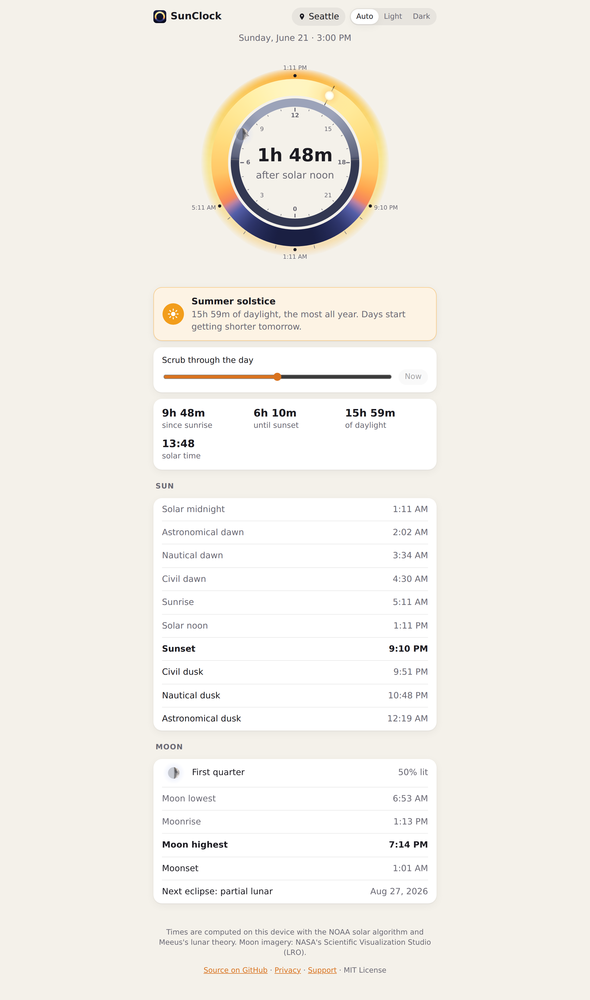

### web-1-seattle-june-light

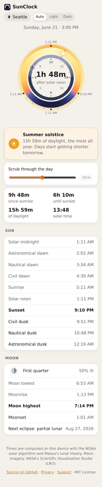

### web-10-welcome-light

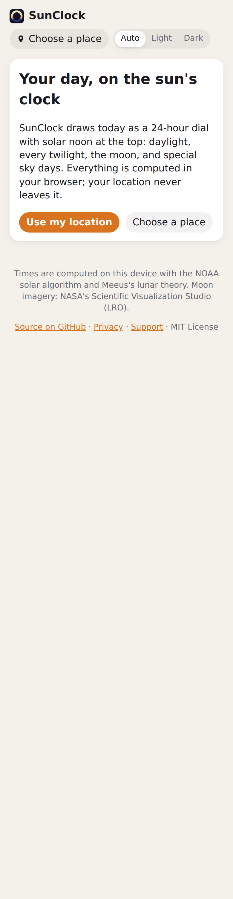

### web-2-seattle-june-dark-desktop

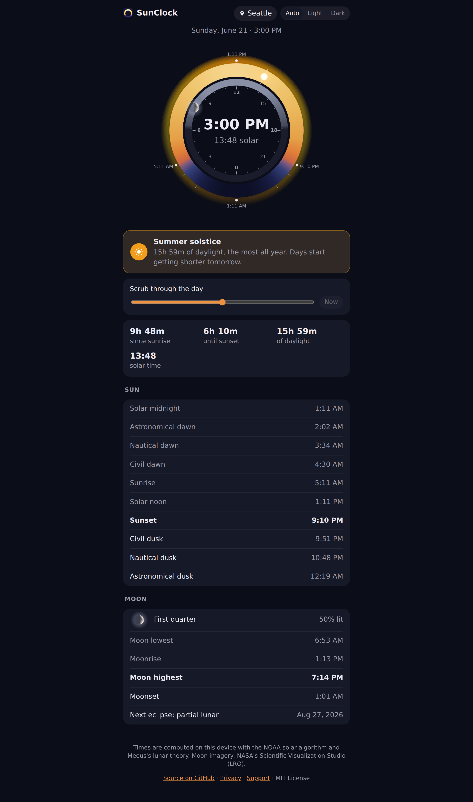

### web-2-seattle-june-dark

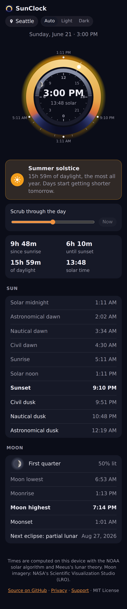

### web-3-seattle-december-night-dark

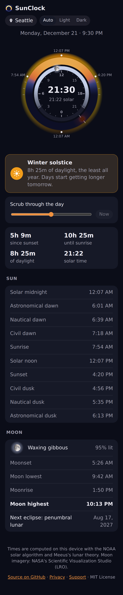

### web-4-tromso-midnight-sun-light

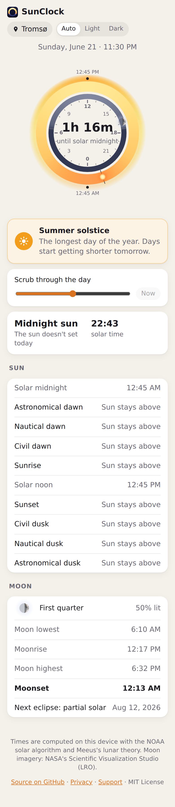

### web-5-supermoon-dark

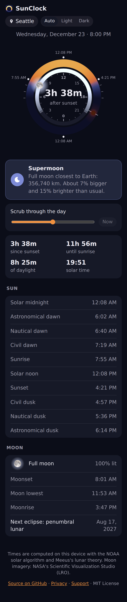

### web-6-blood-moon-dark

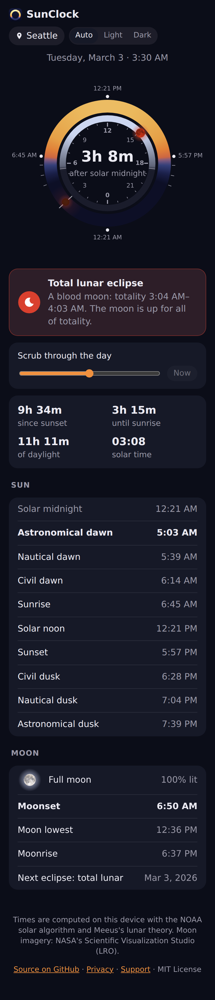

### web-7-total-solar-eclipse-light

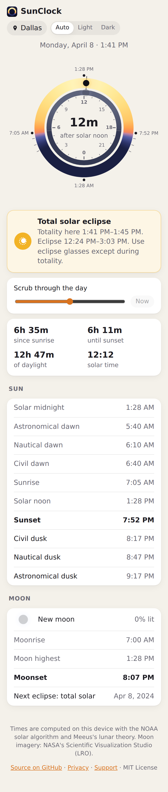

### web-8-summer-solstice-light

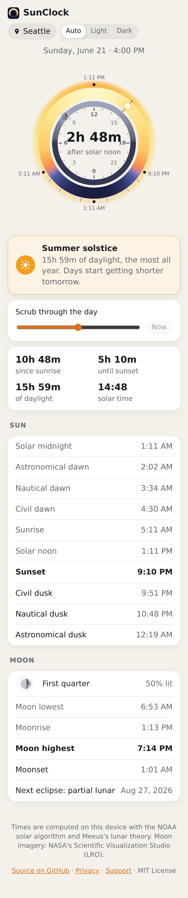

### web-9-new-moon-dark

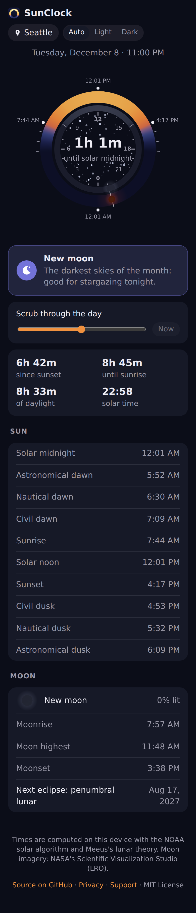
