# SunClock web screenshots

From `sunclock` at 47cb596, 2026-10-27 17:44 UTC. Replaced on every push.

### web-1-seattle-june-light-desktop

### web-1-seattle-june-light

### web-10-welcome-light

### web-11-now-at-top-light

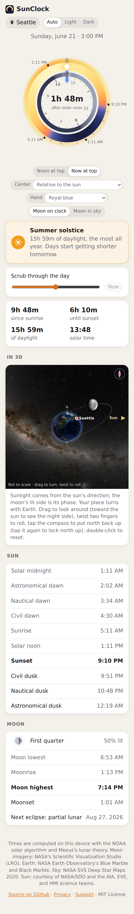

### web-12-now-at-top-night-dark

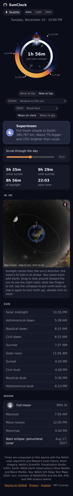

### web-13-moon-in-sky-first-quarter-light

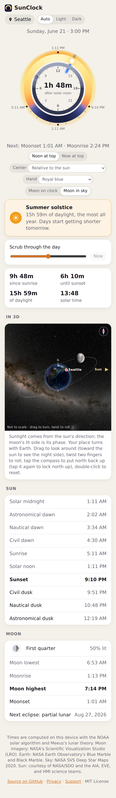

### web-14-moon-in-sky-full-dark

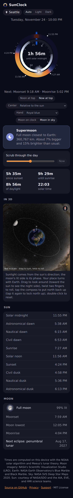

### web-15-moon-in-sky-crescent-light

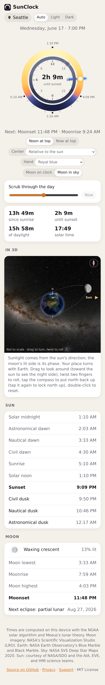

### web-16-3d-first-quarter

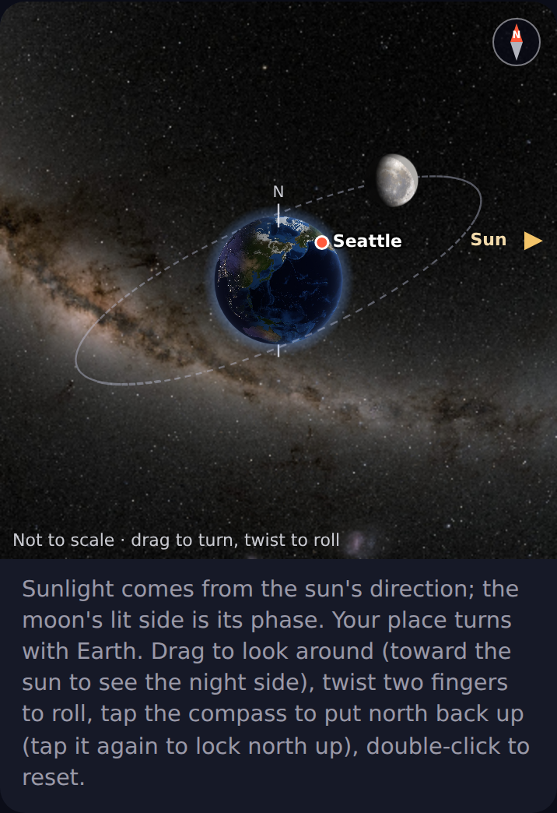

### web-17-3d-full-moon

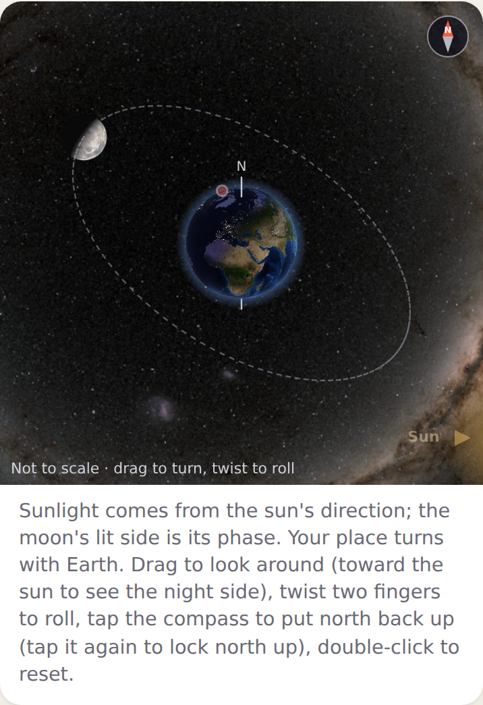

### web-18-3d-blood-moon

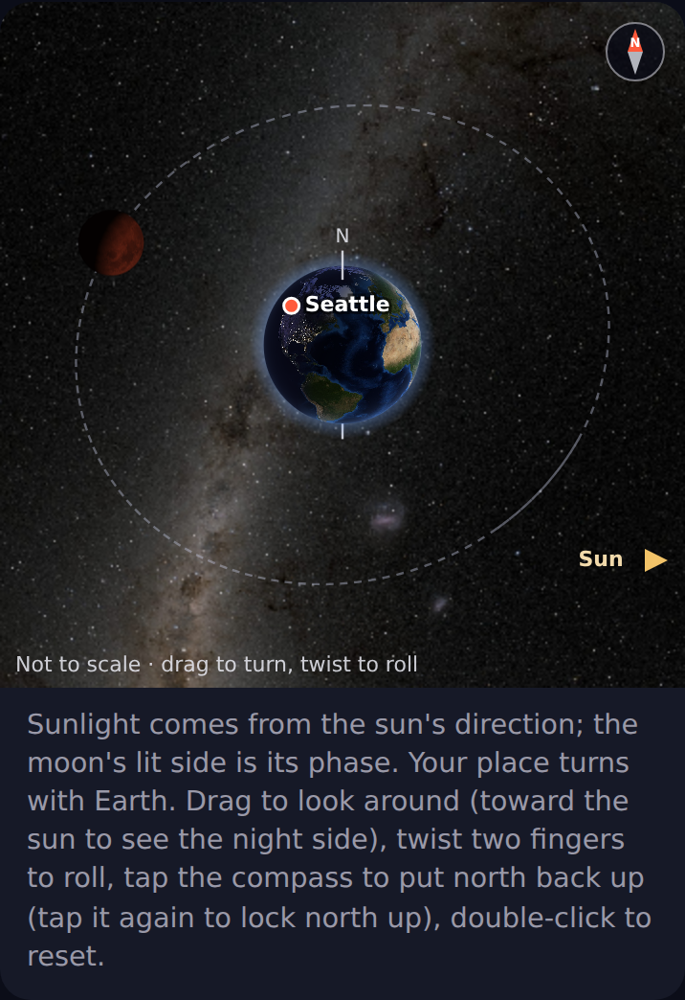

### web-19-hand-gold-dark

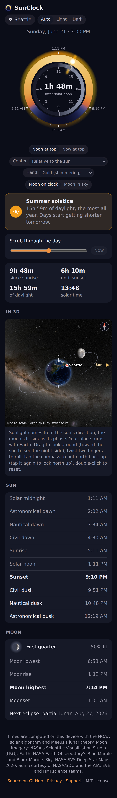

### web-2-seattle-june-dark-desktop

### web-2-seattle-june-dark

### web-20-hand-cyan-light

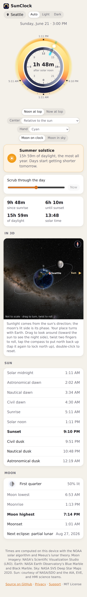

### web-21-sun-periods-light

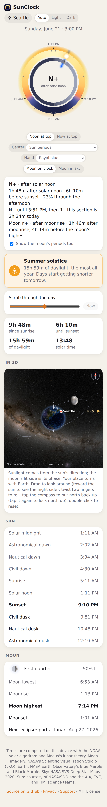

### web-22-sun-periods-sunset-dark

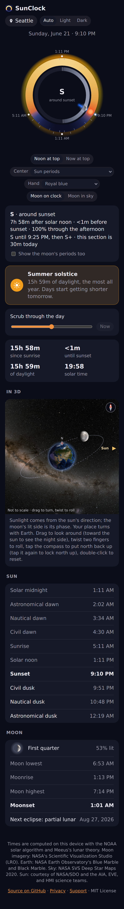

### web-23-wadokei-dark

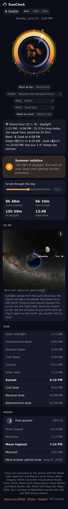

### web-24-wadokei-night-dark

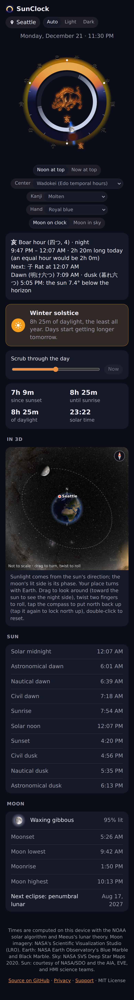

### web-25-wadokei-light

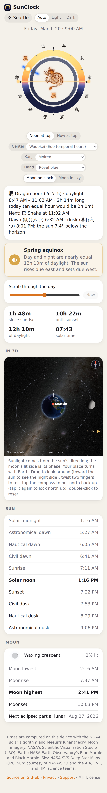

### web-26-wadokei-gold-dark

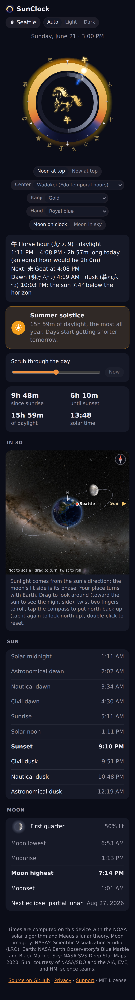

### web-27-wadokei-silver-light

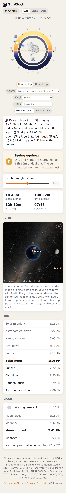

### web-28-wadokei-plain-dark

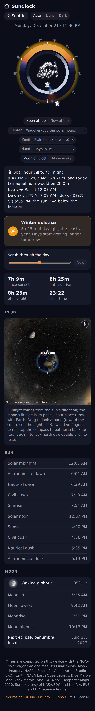

### web-29-wadokei-gold-light

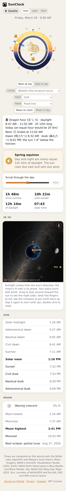

### web-3-seattle-december-night-dark

### web-30-roman-light

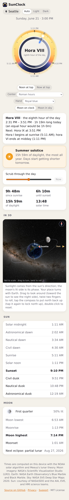

### web-31-roman-night-dark

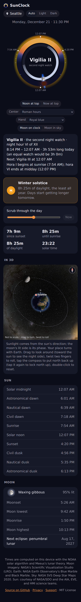

### web-32-zenith-passage-light

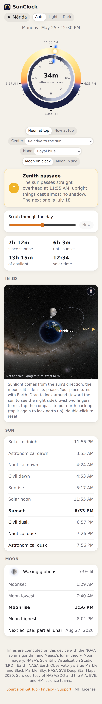

### web-4-tromso-midnight-sun-light

### web-5-supermoon-dark

### web-6-blood-moon-dark

### web-7-total-solar-eclipse-light

### web-8-summer-solstice-light

### web-9-new-moon-dark

